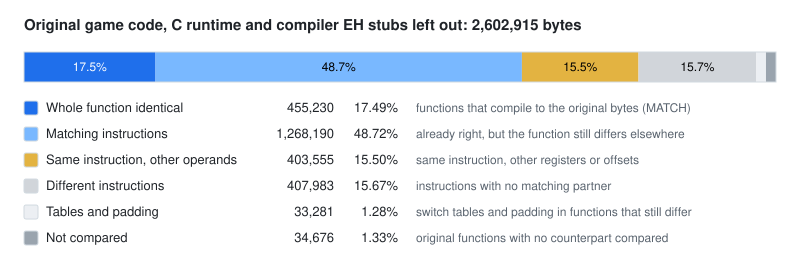

# Byte matching

Redivivus is the shipped 1.14d `Game.exe`, recovered as source that builds. Byte matching
is how that claim is checked, one function at a time: compile the tree with the compiler
that built the original, Visual C++ 2005 SP1, and compare the machine code of each
function with the code in the shipped executable.

Where the code comes out identical, the source is a faithful reading of that function. Where it
does not, the difference shows where the reading is still off.

<picture>
  <source media="(prefers-color-scheme: dark)" srcset="asm_matching/msvc8/evidence/byte-match-dark.svg">
  
</picture>

## What is compared

Both sides are reduced to the same view before they are compared:

- **The original** is carved into functions and decoded instruction by instruction, so
  switch tables and padding are never read as code.
- **The rebuild** is read from the compiler's object files, one section per function, with
  the exact relocations.
- **Addresses are masked.** The rebuild links at different addresses, so every field that
  holds an address is compared by *what it names* instead: a function by its original
  address, an import by name, a string by its content, a switch table by its offset. A call
  to the wrong function still counts as a difference; a call to the right function at a
  different address does not.

Nothing else is masked. Register choice, instruction order, stack-frame layout and
constants must all be identical.

## The kinds of match

Each function gets one status, from strictest to loosest:

|Status|In plain words|
|-|-|
|`MATCH`|The whole function is identical, and every function, string and import it refers to is the right one|
|`REF_DIFF`|Identical bytes, but a reference names a different function, string or import|
|`INSN_MATCH`|The same instructions in the same order, but some registers or offsets differ|
|`INSN_COUNT_MATCH`|The same number of instructions, but some are different instructions|
|`OUR+N` / `OUR-N`|The rebuild has N more or N fewer instructions than the original|

The headline counts only `MATCH`. One differing instruction anywhere in a function, a
register picked differently, say, keeps the whole function out. That makes the headline
strict, and it is why it looks low next to the second figure below.

## Two figures

The headline counts the bytes of **whole matching functions**.

Inside functions that do not match yet, most instructions usually already do. The audit
aligns the two instruction sequences of every compared function and counts the original's
bytes that sit in identical instructions. That second figure is always higher. Both are
honest; they answer different questions:

- **Whole functions:** how much of the program is provably the original code?
- **Matching instructions:** how much of the code is already right, even in functions that still differ elsewhere?

The diagram above splits the original's code into these kinds. Its numbers come from
the same run as [`audit.tsv.summary`](asm_matching/msvc8/evidence/audit.tsv.summary).

## What is counted

- **The denominator is the original's code**, function by function, at its real extent.
  Padding between functions is not counted. A switch table inside a function is counted the
  same way on both sides.
- **The C runtime is left out.** Visual C++ 2005 linked its runtime (libcmt) into the
  original statically, and the rebuild links a runtime instead of reconstructing it. Those
  functions are paired with the compiler's own libraries and still measured, but they are
  not in the headline. The whole-binary figures, runtime included, are in the summary as well.
- **Code the compiler generates for C++ exceptions is left out:** the `__ehhandler` stubs
  and the unwind funclets the binary's own exception tables name. No source line produces
  them on their own; they come with the function that has the `try` or the destructor.
- **Original functions with no counterpart in the tree** count as not matching. They are
  real gaps.

## What it does not say

- **A function that does not match is not necessarily wrong.** It may behave identically
  and differ in register allocation or block order. The reverse holds, though: a matching
  function is the original code.
- **It says nothing about the C++ around the code:** names, comments, how the source is
  split into files. Those come from the reverse engineering, not from the compiler.
- **It is one compiler's view.** The Mac build of 1.14 is the same game compiled by a
  different compiler, and would see different things.

## Running it

The oracle is in [`asm_matching/msvc8/`](asm_matching/msvc8/README.md). It needs the
original `Game.exe` and the compiler. It runs under wine on macOS and Linux, and in CI the
tree is compiled with the same compiler on every change. Its README covers setup, how
functions are paired and judged, the per-directory flags, and how to read `oracle diff`.
