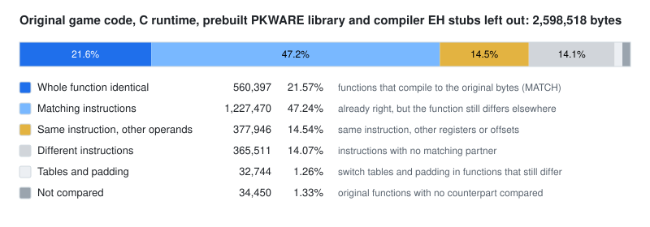

# Redivivus

[](https://discord.gg/MHK2Dg9)
[](https://redivivus.app)

Diablo II: Lord of Destruction 1.14d, reverse-engineered into C++ that builds and runs.

|At this commit|Ghidra database v2094|
|-|-|
|Build|every translation unit compiles with a strict `-std=c++17`, no `-fpermissive`; the executable links with no undefined symbol|
|Play|single player works; a full playthrough has been completed on the Visual C++ 2005 build|
|Modules|22 libraries, one per original module; 4 strict, with no include the original DLL imports did not allow|
|64-bit|all 464 files compile for x64 with Visual C++ 2005; 890 pointer-width casts left (from 7,955), [counted](asm_matching/msvc8/x64/README.md) by that compiler|

Machine code identical to 1.14d, compiled with Visual C++ 2005 SP1, the compiler of the original:

|Measure|Identical machine code|
|-|-|
|Functions|8,507 of 14,644 (58.1%)|
|Code|736,851 of 2,600,766 bytes (28.33%)|
|Instructions|1,861,721 of 2,600,766 bytes (71.6%), counting identical instructions in functions that still differ|

<picture>
  <source media="(prefers-color-scheme: dark)" srcset="asm_matching/msvc8/evidence/byte-match-dark.svg">
  
</picture>

What is compared, what is left out (the C runtime, compiler-made exception code, PKWARE) and
the figures over the whole binary: [BYTE-MATCHING.md](BYTE-MATCHING.md).

*Redivivus* is Latin for a thing restored to life. Next to the game mechanics it carries the
parts that make the game run at all: the program host and its main loop, the renderers, sound,
input, files and archives, the network layer, and Blizzard's Storm and Fog libraries. The tree is
generated from reverse-engineered Ghidra databases and corrected where needed, so the names,
types and structure are reconstructions, and some functions still read like a decompiler wrote
them. How it is laid out: [docs/layout.md](docs/layout.md). How it came about:
[redivivus.app/about](https://redivivus.app/about).

Redivivus is a single-player project, made to study and preserve the game. Online play on
Battle.net is outside its scope.

## Build and run

You need your own Diablo II: Lord of Destruction 1.14 installation; this repository holds no
game data. With a mingw-w64 cross compiler for 32-bit Windows, CMake and Ninja:

```sh
cmake -S . -B build -G Ninja -DCMAKE_TOOLCHAIN_FILE=cmake/mingw-i686.cmake
cmake --build build
```

Copy `build/d2.exe` next to `Game.exe` in your Diablo II folder and run `d2.exe -w`.
Per platform, and with the original compilers: [docs/building.md](docs/building.md),
[docs/original-compilers.md](docs/original-compilers.md).

## Known issues

- When an NPC has quest news, the scrolling text box does not appear; the quest itself advances.
- It can still crash, rarely. A crash writes a report with a stack trace next to the executable;
  please attach it to an [issue](https://github.com/jaenster/redivivus/issues).
  Where the reports land: [docs/crash-reports.md](docs/crash-reports.md).

## Contributing

Most of the tree is regenerated, so a fix in the reverse-engineering (a wrong type, a missing
parameter) is best sent as a proposal against the Ghidra databases: it is checked, reviewed,
and applied with you as the git author. With Claude Code:

```
claude plugin marketplace add jaenster/redivivus
claude plugin install redivivus@redivivus
```

Other agents, pull requests and which paths are generated: [CONTRIBUTING.md](CONTRIBUTING.md)
and [redivivus.app/about#contributing](https://redivivus.app/about#contributing).

## Credits

- Much of the 1.14d reverse-engineering comes from [blizzhackers](https://blizzhackers.dev),
  dzik in particular.
- The byte-match oracle in `asm_matching/` is Niehztog's, and Nugwa628 found many of the
  difference classes it measures.
- [D2MOO](https://github.com/ThePhrozenKeep/D2MOO) supplied many of the structure layouts
  this work started from in 2021, though it went another direction since.

## License

MIT, see [LICENSE](LICENSE). Code under `3rdparty/libbacktrace/` keeps its own license.

The `.cpp.map` files map every function and line back to its address in 1.14d `Game.exe`. They
are part of this work under the same license: if you use them, credit Redivivus and link here.

Diablo and Blizzard Entertainment are trademarks of Blizzard Entertainment, Inc. This
project is not affiliated with or endorsed by Blizzard.
